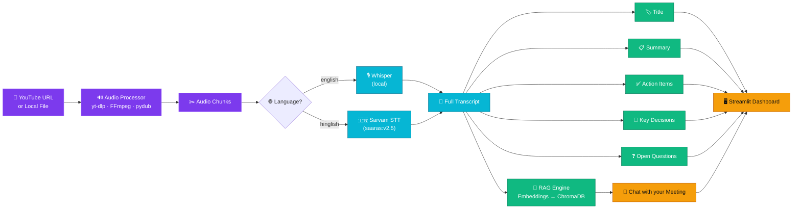
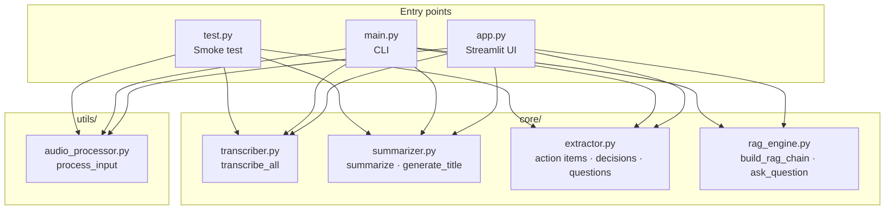
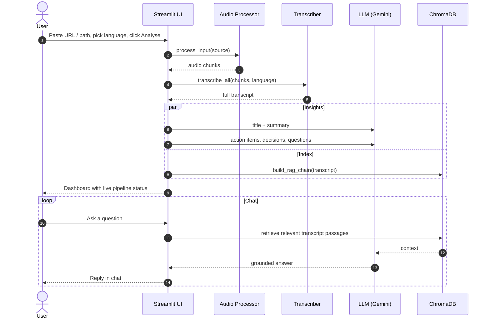

<div align="center">

# 🎬 AI Video Assistant

### Transcribe · Summarise · Extract · Chat with your meetings

Paste a YouTube link or a local video file and get a clean transcript, summary, action items, key decisions, open questions, and a chatbot that answers questions about the recording.

<br/>


</div>

---

## 📖 Table of Contents

- [✨ Features](#-features)
- [🏗️ Architecture](#️-architecture)
- [🔄 How a Request Flows](#-how-a-request-flows)
- [🧰 Tech Stack](#-tech-stack)
- [📁 Project Structure](#-project-structure)
- [🚀 Getting Started](#-getting-started)
- [⚙️ Configuration](#️-configuration)
- [🖥️ Usage](#️-usage)
- [🗺️ Roadmap](#️-roadmap)
- [🤝 Contributing](#-contributing)
- [👤 Author](#-author)

---

## ✨ Features

| | Feature | What you get |
|---|---|---|
| 🔊 | **Flexible input** | Paste a YouTube URL or point to a local audio/video file |
| 📝 | **Accurate transcription** | Local **OpenAI Whisper** for English, **Sarvam AI** for Hinglish |
| 🏷️ | **Auto title** | A concise, meaningful title generated from the content |
| 📋 | **Smart summary** | A readable summary of the whole recording |
| ✅ | **Action items** | Tasks and follow-ups pulled out of the conversation |
| 🔑 | **Key decisions** | What was actually decided, separated from the chatter |
| ❓ | **Open questions** | Unresolved points that still need answers |
| 💬 | **Chat with your video** | RAG-powered Q&A grounded in the transcript |
| 🎨 | **Polished dark UI** | Custom-styled Streamlit app with live pipeline status |
| ⌨️ | **CLI mode** | Run the full pipeline from the terminal with `main.py` |

---

## 🏗️ Architecture

The app is a linear pipeline that feeds a retrieval layer. Everything after transcription works on the transcript text.



### Module map



---

## 🔄 How a Request Flows



---

## 🧰 Tech Stack

| Layer | Tools |
|---|---|
| **UI** | Streamlit, custom CSS (Syne + JetBrains Mono, dark theme) |
| **Audio acquisition** | `yt-dlp`, `ffmpeg-python`, `pydub` |
| **Speech-to-text** | OpenAI Whisper (local, via PyTorch), Sarvam AI `saaras:v2.5` |
| **Translation** | `deep-translator` |
| **LLM orchestration** | LangChain (LCEL), Google Gemini, Mistral AI client |
| **RAG** | ChromaDB, `sentence-transformers`, `langchain-huggingface`, `tiktoken` |
| **Export helpers** | `reportlab`, `fpdf2` |
| **Utilities** | `python-dotenv`, `numpy`, `tqdm`, `requests` |

---

## 📁 Project Structure

```text
AI-Video-Assistant-/
├── 📂 core/                  # Intelligence layer
│   ├── transcriber.py        #   Whisper / Sarvam speech-to-text
│   ├── summarizer.py         #   Title + summary generation
│   ├── extractor.py          #   Action items, decisions, open questions
│   └── rag_engine.py         #   Vector store + Q&A chain
├── 📂 utils/
│   └── audio_processor.py    # Download / convert / chunk audio
├── app.py                    # 🎨 Streamlit web app
├── main.py                   # ⌨️ CLI pipeline + terminal chat
├── test.py                   # 🧪 Quick end-to-end smoke test
├── Requirements.txt          # Python dependencies
├── .env.example              # Template for API keys and model settings
└── .gitignore
```

---

## 🚀 Getting Started

### Prerequisites

- **Python 3.10+**
- **FFmpeg** installed and available on your `PATH` (required by `pydub` and `yt-dlp`)
  - macOS: `brew install ffmpeg`
  - Ubuntu/Debian: `sudo apt install ffmpeg`
  - Windows: `choco install ffmpeg` or download from [ffmpeg.org](https://ffmpeg.org/download.html)
- A **Google Gemini API key** and a **Sarvam AI API key** (Sarvam is only needed for Hinglish)

### Installation

```bash
# 1. Clone the repository
git clone https://github.com/u23ec179/AI-Video-Assistant-.git
cd AI-Video-Assistant-

# 2. Create and activate a virtual environment
python -m venv venv
source venv/bin/activate        # Windows: venv\Scripts\activate

# 3. Install dependencies
pip install -r Requirements.txt

# 4. Set up your environment variables
cp .env.example .env            # Windows: copy .env.example .env
# then open .env and add your keys
```

> 💡 The first run downloads the Whisper model and the embedding model, so it can take a few minutes.

---

## ⚙️ Configuration

Edit your `.env` file:

```env
GEMINI_API_KEY=your_gemini_api_key
SARVAM_API_KEY=your_sarvam_api_key
WHISPER_MODEL=small
SARVAM_STT_MODEL=saaras:v2.5
```

| Variable | Purpose | Notes |
|---|---|---|
| `GEMINI_API_KEY` | LLM for title, summary, extraction and chat | Required |
| `SARVAM_API_KEY` | Hinglish speech-to-text | Needed only for `hinglish` |
| `WHISPER_MODEL` | Local Whisper size | `tiny`, `base`, `small`, `medium`, `large`. Bigger is more accurate but slower |
| `SARVAM_STT_MODEL` | Sarvam model name | Default `saaras:v2.5` |

> 🔐 Never commit your real `.env`. It is already covered by `.gitignore`.

---

## 🖥️ Usage

### 🎨 Web app (recommended)

```bash
streamlit run app.py
```

1. Paste a **YouTube URL** or a **local file path** in the sidebar
2. Choose the language: `english` or `hinglish`
3. Click **⚡ Analyse** and watch the live pipeline status
4. Read the title, summary, action items, decisions and open questions
5. Scroll down to **💬 Chat with your Meeting** and ask anything

### ⌨️ Command line

```bash
python main.py
```

You'll be prompted for a source and language. The results print in the terminal, followed by an interactive chat. Type `exit` to quit.

### 🧪 Smoke test

```bash
python test.py
```

Runs transcription, summary and extraction on a sample YouTube video (edit `source` in the file to try your own).

---

## 🗺️ Roadmap

- [ ] Export results as PDF / TXT (libraries already included)
- [ ] Speaker diarization
- [ ] Timestamped transcript with click-to-seek
- [ ] More languages beyond English and Hinglish
- [ ] Docker image for one-command setup
- [ ] Persistent chat and saved sessions

---

## 🤝 Contributing

Contributions, issues and feature requests are welcome.

1. Fork the repo
2. Create your branch: `git checkout -b feature/amazing-feature`
3. Commit your changes: `git commit -m "Add amazing feature"`
4. Push: `git push origin feature/amazing-feature`
5. Open a Pull Request

---

## 👤 Author

**Deepak** — B.Tech ECE, SVNIT Surat
GitHub: [@u23ec179](https://github.com/u23ec179)

<div align="center">

⭐ If this project helped you, consider giving it a star.

</div>
